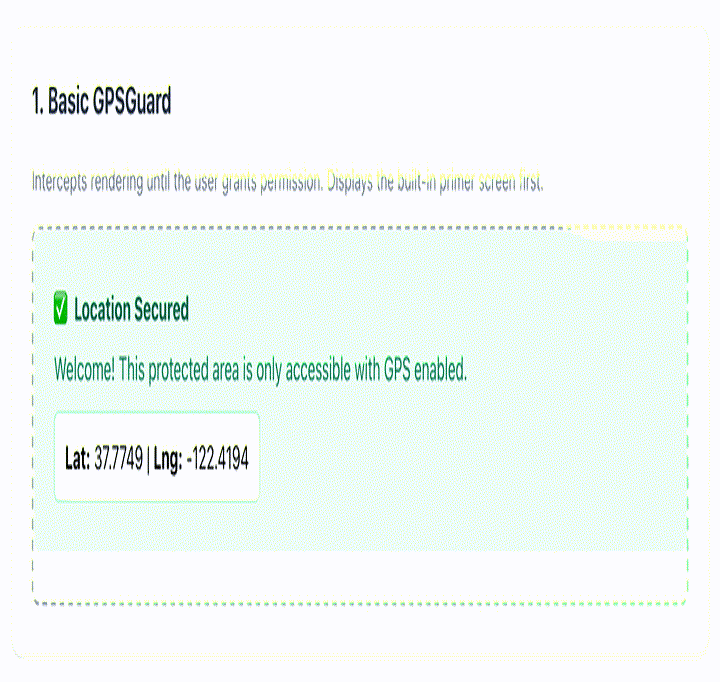
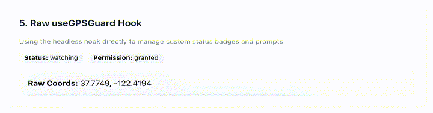
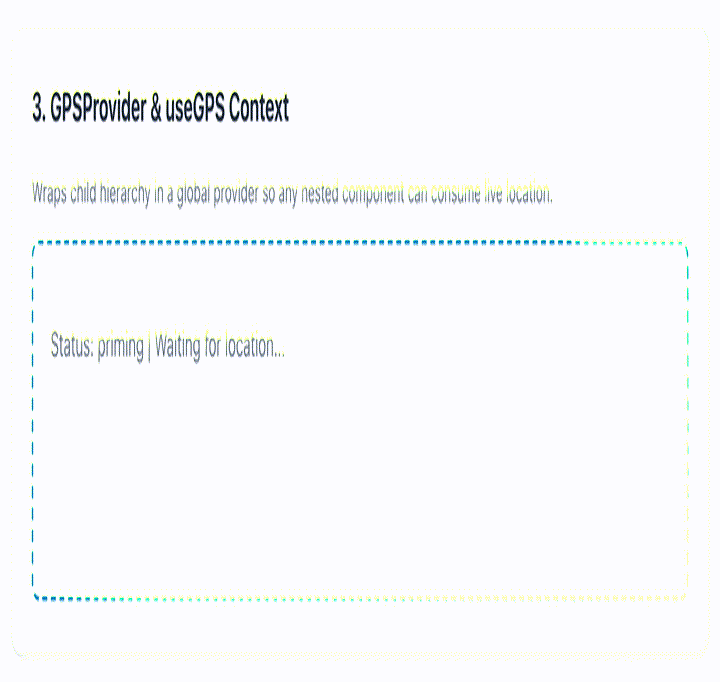
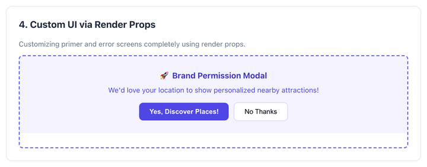
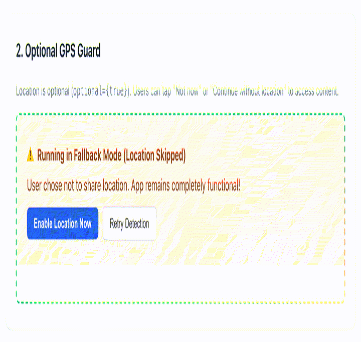

# react-gps-guard

A production-quality React component and hook library for seamlessly handling GPS/Geolocation permissions, prompting, and continuous tracking.

## Features

- **Component & Hook APIs**: Use the declarative `<GPSGuard>` or the `useGPSGuard` hook.
- **Optional Location Support**: Seamlessly make GPS optional with `optional={true}` so users can skip or continue without giving permission.
- **Global Context Support**: Wrap your app in `<GPSProvider>` and use `useGPS()` anywhere.
- **Robust Permission Handling**: Gracefully handles permissions, primer screens, denied states, and disabled GPS scenarios.
- **Fully Customizable**: Provides clean default UI components while allowing you to easily swap them out.
- **Cross-Platform**: Handles differences between iOS, Android, Desktop, and SSR.
- **Strongly Typed**: Built with TypeScript for excellent developer experience.
- **Modern Module Support**: Exports ESM and CommonJS. Supports React 18 and 19.

---

## Installation

```bash
npm install react-gps-guard
```

Make sure you have `react` and `react-dom` installed.

---

## Quick Start

Import the default CSS to get the out-of-the-box styling:

```tsx
import 'react-gps-guard/styles.css';
import { GPSGuard } from 'react-gps-guard';

function App() {
  return (
    <GPSGuard onLocation={(loc) => console.log('Location:', loc)}>
      <div>
        <h1>Welcome!</h1>
        <p>You can only see this if location is enabled.</p>
      </div>
    </GPSGuard>
  );
}
```

---

## Comprehensive Usage Guide

### 1. Basic Component Usage

The `<GPSGuard>` component acts as a boundary. It intercepts the rendering of its children until the user grants location permissions and a valid location is retrieved.



```tsx
import { GPSGuard } from 'react-gps-guard';
import 'react-gps-guard/styles.css';

export function MapFeature() {
  return (
    <GPSGuard
      enableHighAccuracy={true}
      timeout={10000}
      enablePrimer={true}
      onLocation={(loc) => console.log('Got coordinates:', loc.latitude, loc.longitude)}
      onError={(err) => console.error('GPS Error:', err.message)}
    >
      <MyMapComponent />
    </GPSGuard>
  );
}
```

### 2. Using the Hook (`useGPSGuard`)

If you want complete control over the UI and rendering lifecycle, use the `useGPSGuard` hook directly. This hook does not block rendering, it simply returns the current state.



```tsx
import { useGPSGuard } from 'react-gps-guard';

export function MyLocationComponent() {
  const { 
    location, 
    permission, 
    status, 
    error,
    requestPermission,
    retry
  } = useGPSGuard({
    enableHighAccuracy: true,
    distanceFilter: 10 // Only update if user moves 10 meters
  });

  if (status === 'checking') return <p>Checking permissions...</p>;
  
  if (status === 'priming' || permission === 'prompt') {
    return (
      <div>
        <p>We need your location to show nearby stores.</p>
        <button onClick={requestPermission}>Allow Location</button>
      </div>
    );
  }

  if (status === 'error' || permission === 'denied') {
    return (
      <div>
        <p>Location Error: {error?.message}</p>
        <button onClick={retry}>Retry</button>
      </div>
    );
  }

  return (
    <div>
      <p>Your location: {location?.latitude}, {location?.longitude}</p>
    </div>
  );
}
```

### 3. Using the Context Provider

To access the user's location from anywhere in your app without prop-drilling or showing multiple permission prompts, wrap your app in a `<GPSProvider>`.



**Setup the Provider:**

```tsx
import { GPSProvider } from 'react-gps-guard';
import 'react-gps-guard/styles.css';

export function App() {
  return (
    <GPSProvider autoRetry={true}>
      <Dashboard />
    </GPSProvider>
  );
}
```

**Consume the Context:**

```tsx
import { useGPS } from 'react-gps-guard';

export function Dashboard() {
  const { location, loading, requestPermission, status } = useGPS();

  if (loading) return <p>Loading...</p>;

  if (status === 'priming') {
    return <button onClick={requestPermission}>Enable Tracking</button>;
  }

  return (
    <div>
      <h2>Dashboard</h2>
      {location ? (
        <p>Tracking active! Lat: {location.latitude}</p>
      ) : (
        <p>Waiting for location...</p>
      )}
    </div>
  );
}
```

### 4. Customizing UI Components

You can override the default screens of the `GPSGuard` by passing React components to specific props.

```tsx
import { GPSGuard } from 'react-gps-guard';

<GPSGuard
  loadingComponent={
    <div className="my-spinner">Loading GPS...</div>
  }
  permissionComponent={
    <div className="my-modal">
      <h2>Location Required</h2>
      <p>Please accept our custom permission prompt.</p>
      {/* Note: In this mode, you need to use render props to actually trigger requestPermission. See below. */}
    </div>
  }
  errorComponent={
    <div className="my-error">Oops, something went wrong.</div>
  }
>
  <MainApp />
</GPSGuard>
```

### 5. Customizing UI via Render Props

For the most flexibility inside the `<GPSGuard>`, use the render props which pass down the required control functions (like `requestPermission` and `retry`).



```tsx
import { GPSGuard } from 'react-gps-guard';

<GPSGuard
  renderLoading={() => <div className="spinner" />}
  
  renderPermission={(requestPermission, decline) => (
    <div className="custom-primer">
      <h2>We need your location</h2>
      <button onClick={requestPermission}>Allow Access</button>
      <button onClick={decline}>No Thanks</button>
    </div>
  )}
  
  renderError={(error, retry) => (
    <div className="custom-error">
      <h2>Could not get location</h2>
      <p>{error?.message}</p>
      <button onClick={retry}>Try Again</button>
    </div>
  )}
>
  <MainApp />
</GPSGuard>
```

### 6. Optional Location Mode

If your application doesn't strictly require location, you can pass `optional={true}` (or simply `optional`) to `<GPSGuard>`.

In this mode:
- If the user clicks **Not now** on the primer, they immediately proceed to your app content without being blocked.
- If location permission is denied or GPS is disabled, the error screen provides a **Continue without location** button (or you can use `skipOnError` to bypass error screens entirely).
- You can provide a function as `children` to access location, whether the user skipped (`isSkipped`), and retry controls.



```tsx
import { GPSGuard } from 'react-gps-guard';
import 'react-gps-guard/styles.css';

export function StoreLocator() {
  return (
    <GPSGuard optional onSkip={() => console.log('User skipped location')}>
      {({ location, isSkipped, requestPermission }) => (
        <div>
          {isSkipped ? (
            <div>
              <p>Showing global recommendations.</p>
              <button onClick={requestPermission}>Enable Location for Local Results</button>
            </div>
          ) : (
            <p>Showing stores near {location?.latitude}, {location?.longitude}</p>
          )}
        </div>
      )}
    </GPSGuard>
  );
}
```

---

## API Reference

### Configuration Options (`GPSOptions`)

These options can be passed to `<GPSGuard>`, `<GPSProvider>`, or `useGPSGuard`.

| Option | Type | Default | Description |
|---|---|---|---|
| `enableHighAccuracy` | `boolean` | `true` | Request highest possible accuracy (GPS vs WiFi/Cellular). |
| `timeout` | `number` | `10000` | Max time in ms allowed to retrieve the location. |
| `maximumAge` | `number` | `0` | Max age in ms of a cached location. `0` means always fresh. |
| `distanceFilter` | `number` | `undefined` | Only trigger `onLocation` if moved by this many meters. |
| `autoRetry` | `boolean` | `false` | Automatically retry on certain transient errors. |
| `retryInterval` | `number` | `3000` | Wait time in ms before auto-retrying. |
| `enablePrimer` | `boolean` | `true` | Show a friendly primer component before the native browser prompt. |
| `showInstructions` | `boolean` | `true` | Show OS-specific recovery instructions on the error screen when denied. |
| `stopAfterMs` | `number` | `undefined` | Optional time in milliseconds to automatically stop tracking after it starts. |
| `optional` | `boolean` | `false` | When true, location is optional and users can decline or skip to continue. |
| `skipOnError` | `boolean` | `false` | When optional is true, automatically proceed without showing error screen on failure. |

### Component Props (`GPSGuardProps`)

In addition to all `GPSOptions` and `GPSCallbacks`, `<GPSGuard>` accepts:

| Prop | Type | Default | Description |
|---|---|---|---|
| `optional` | `boolean` | `false` | Enables optional mode. |
| `allowSkip` | `boolean` | `optional` | Whether to show the skip / continue button. |
| `skipButtonText` | `string` | `'Continue without location'` | Custom label for skip button. |
| `children` | `ReactNode \| (props) => ReactNode` | - | App content to guard or render prop receiving location and skip states. |
| `loadingComponent` | `ReactNode` | `<DefaultLoading />` | Custom loading component. |
| `permissionComponent` | `ReactNode` | `<DefaultPrimer />` | Custom primer component. |
| `errorComponent` | `ReactNode` | `<DefaultError />` | Custom error component. |
| `renderLoading` | `() => ReactNode` | - | Custom render prop for loading state. |
| `renderPermission` | `(requestPermission, decline, skip) => ReactNode` | - | Custom render prop for primer state. |
| `renderError` | `(error, retry, skip) => ReactNode` | - | Custom render prop for error state. |

### Event Callbacks (`GPSCallbacks`)

| Callback | Signature | Description |
|---|---|---|
| `onReady` | `() => void` | Fires when the package is initialized and ready. |
| `onLocation` | `(location: GPSLocation) => void` | Fires whenever a new location is retrieved. |
| `onPermissionGranted` | `() => void` | Fires when the user grants native permission. |
| `onPermissionDenied` | `() => void` | Fires when the user denies native permission. |
| `onPermissionPrompt` | `() => void` | Fires right before the native browser prompt is triggered. |
| `onGPSDisabled` | `() => void` | Fires when position is unavailable (often means GPS hardware is off). |
| `onError` | `(error: GPSError) => void` | Fires on any error. |
| `onStartWatching` | `() => void` | Fires when continuous tracking begins. |
| `onStopWatching` | `() => void` | Fires when tracking ends. |
| `onSkip` | `() => void` | Fires when the user skips or chooses to continue without location. |

### Types

**`GPSLocation`**
```ts
type GPSLocation = {
  latitude: number;
  longitude: number;
  accuracy?: number;
  altitude?: number | null;
  altitudeAccuracy?: number | null;
  heading?: number | null;
  speed?: number | null;
  timestamp?: number;
};
```

**`GPSStatus`**
`'idle' | 'checking' | 'priming' | 'watching' | 'error' | 'skipped'`

**`GPSPermissionState`**
`'prompt' | 'granted' | 'denied' | 'unsupported'`

**`GPSError`**
```ts
type GPSError = {
  code: 'PERMISSION_DENIED' | 'POSITION_UNAVAILABLE' | 'TIMEOUT' | 'UNSUPPORTED' | 'UNKNOWN';
  message: string;
};
```

---

## Styling

If you are using the default `<GPSGuard>` components, you must import the CSS:
```ts
import 'react-gps-guard/styles.css';
```

The styles are lightweight and scoped using the `.gps-guard-*` class prefix. You can easily override these classes in your own global CSS files. 

For example, to change the primary button color:
```css
.gps-guard-btn-primary {
  background-color: #ff5722 !important;
}
```

## License
MIT
# react-gps-guard
